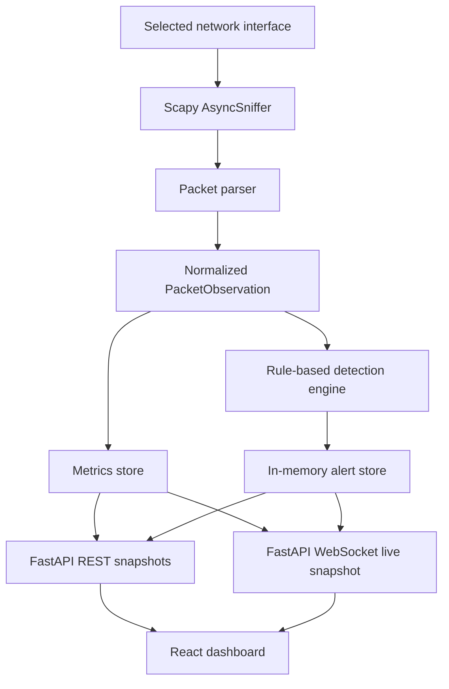

# Product Requirements Document (PRD)

# Network Traffic Analyzer & Anomaly Detector

**Document type:** Implementation-ready PRD for a coding agent  
**Project type:** College mini-project  
**Version:** 1.0  
**Status:** Build specification  
**Primary stack:** React + TypeScript, FastAPI + Python, Scapy  
**Operating environment:** Local Linux machine, isolated VM lab, or Mininet lab  

---

## 1. Instructions to the Coding Agent

Treat this document as the source of truth for the first release. Implement the application in the phases listed in Section 14. Do not expand the scope into a full enterprise security platform.

Before changing code:

1. Inspect the existing repository and identify its language, package manager, current files, and any working functionality.
2. If the repository is empty, create the structure described in Section 6. If it already has a reasonable structure, preserve it where practical and map the components in this PRD to that structure.
3. Create a concise `IMPLEMENTATION_PLAN.md` or `tasks.md` containing the phases and checkboxes. Keep it updated as phases are completed.
4. Implement a runnable vertical slice early: backend health check, React page, and successful frontend-to-backend communication.
5. Implement and test packet parsing and detection independently of live packet capture. Unit tests must run without root privileges or a real network interface.
6. Do not claim a phase is complete unless its acceptance criteria pass. Run the relevant tests, type checks, and build commands. Fix failures rather than documenting them as successful.
7. Prefer small, readable modules, typed API contracts, clear error handling, and comments explaining non-obvious detection logic. Avoid needless abstractions and dependency-heavy frameworks.
8. Do not add a database, machine-learning model, user accounts, cloud deployment, packet blocking, or packet payload inspection. These are outside the MVP scope.
9. Do not create a function that sends, injects, alters, or spoofs packets in the running application. The application is a passive monitor. Any traffic-generation scripts are separate, opt-in lab-test utilities and must target only a documented isolated test network.
10. Keep the API bound to `127.0.0.1` by default. Do not expose a privileged packet-capture service on the LAN or public internet.

When a design choice is not explicitly specified, choose the simplest maintainable option that satisfies this document. Do not stop at a plan or a mock UI: build the working application.

## 2. Product Summary

Build a small, local network-monitoring application that captures packet metadata with Scapy, classifies traffic by protocol, tracks traffic and bandwidth per host, and flags three suspicious patterns:

1. **Port scan:** a source sends TCP SYN packets to many distinct destination ports on the same target within a short time window.
2. **Possible SYN flood:** a target receives an unusually high number of TCP SYN packets without the ACK flag within a short time window.
3. **Possible ARP spoofing:** the same IPv4 address is observed mapping to different MAC addresses in a short time window.

A React dashboard displays capture status, packet summaries, protocol distribution, per-host traffic, recent packet metadata, and a live alert feed. A FastAPI backend owns capture lifecycle, parsing, metrics, rule-based detection, and the REST/WebSocket interface.

This is **not** a Wireshark replacement. Wireshark is a useful reference tool for validating what the lab generates and what the analyzer captures. The product's key distinction is automatic traffic aggregation and rule-based alerting.

### 2.1 Product goal

Deliver a working and demonstrable mini IDS (Intrusion Detection System) that a student can run locally, show to an evaluator, and explain at the network/protocol level.

### 2.2 Success criteria

The MVP is successful when a user can:

- Select a network interface and start or stop packet capture from the browser.
- See live packet counts and protocol distribution update while capture runs.
- See per-host transmitted/received byte counters and approximate bandwidth for a rolling time window.
- Inspect a bounded table of recent packet **metadata** (not payloads).
- Trigger and observe all three detection rules in an authorized isolated lab or in deterministic unit tests.
- Review and acknowledge alerts, including the evidence that caused each alert.
- Run unit tests without elevated permissions and run a documented live lab demonstration with suitable packet-capture permissions.

## 3. Scope

### 3.1 In scope for the MVP

- Local interface discovery and interface selection.
- Explicit user-controlled capture start/stop; capture must not start automatically on server boot.
- Passive Scapy packet capture with packet storage disabled in Scapy (`store=False`).
- Packet parsing for Ethernet where available, IPv4, IPv6, TCP, UDP, ICMP, ICMPv6, and ARP.
- Protocol classification and packet/byte counters.
- Per-host transmitted and received byte totals and rolling bandwidth estimates.
- A bounded recent-packet metadata list.
- Three deterministic, configurable, rule-based detectors: port scan, SYN-rate anomaly, and conflicting ARP mapping.
- A bounded in-memory alert store with deduplication and acknowledgement.
- REST endpoints for capture, interfaces, metrics, packets, alerts, and health.
- A WebSocket endpoint for live dashboard updates.
- A React + TypeScript dashboard with status, charts, tables, filters, and alert details.
- Automated tests for parsing, metrics, all detection rules, APIs, and core frontend behavior where practical.
- Instructions to run locally and demonstrate with Mininet or isolated VMs.

### 3.2 Explicitly out of scope

Do **not** implement these in the MVP:

- Machine learning, model training, model inference, or claims of AI-powered detection.
- Full packet dissection UI, payload display, TCP stream reconstruction, or a Wireshark clone.
- PCAP recording/playback, packet export, payload logging, or persistent packet storage.
- Active defense: dropping packets, firewall rule updates, rate limiting, quarantine, blocking, or automated responses.
- Sending test traffic from the production application.
- Credential collection, decrypted traffic inspection, DPI, TLS inspection, or monitoring application contents.
- Multi-user authentication, roles, organizations, cloud hosting, remote fleet agents, multi-sensor correlation, or distributed deployment.
- Database-backed history, long-term retention, or historical reporting beyond the current in-memory capture session.
- Custom rule authoring in the UI.
- A complex SIEM-style search language.
- Automatic network topology discovery.

Optional enhancements must not delay or destabilize the MVP. Only attempt them after all acceptance criteria pass.

## 4. Intended User and User Stories

### Primary user

A student or evaluator running the application on their own machine or in an isolated virtual network lab.

### User stories

1. As a user, I can select an interface and explicitly start or stop capture so I know when monitoring is active.
2. As a user, I can see whether capture is running, which interface is monitored, and whether permissions or interface selection caused an error.
3. As a user, I can tell which protocols account for the observed traffic.
4. As a user, I can identify hosts generating the most traffic and compare their transmit/receive rates.
5. As a user, I can inspect recent packet headers/metadata without exposing application payloads.
6. As a user, I receive an alert when traffic matches one of the supported suspicious patterns.
7. As a user, I can open an alert and read its source, target, rule, timestamp, and supporting evidence.
8. As a user, I can acknowledge an alert so the dashboard distinguishes reviewed alerts from unreviewed alerts.
9. As a user, I can demonstrate detection using a controlled lab and compare the result with Wireshark or a known test scenario.
10. As a developer, I can unit-test parser and detector logic without root privileges, elevated permissions, or live network traffic.

## 5. Architecture Overview

### 5.1 High-level data flow



### 5.2 Component responsibilities

| Component | Responsibility | Must not do |
|---|---|---|
| React frontend | Display state, charts, packet metadata, host table, alerts; submit user actions | Capture packets, infer detections independently, or assume an API call succeeded before the response |
| FastAPI API layer | Validate requests, expose health/status/data, control capture lifecycle | Contain all parser/detector logic in route functions |
| Capture manager | Discover/validate interfaces and safely start/stop one Scapy sniffer | Start automatically, persist packets, or expose a remote capture agent |
| Packet parser | Convert supported Scapy layers into normalized, serializable observations | Store payload bytes or raise errors that crash the sniffer callback |
| Metrics store | Maintain bounded in-memory rolling counters, protocol counts, per-host counters and recent packet metadata | Grow without limit or persist sensitive traffic data |
| Detection engine | Apply deterministic rules to normalized packet observations | Send packets, block hosts, or claim an alert proves a successful attack |
| Alert store | Deduplicate and bound alerts, update last-seen/count, track acknowledgement | Store packet payloads or grow indefinitely |
| WebSocket publisher | Send small snapshots at a controlled frequency | Broadcast one UI event for every captured packet at high speed |

### 5.3 Design principles

- **Passive:** production application code only observes traffic. It must not transmit packets or actively probe hosts.
- **Metadata-only:** packet records contain headers and derived statistics only; never serialize or persist raw packet payloads.
- **Bounded memory:** all packet/alert/history collections have fixed limits or time-based expiry.
- **Thread safety:** packet capture callbacks may execute outside the FastAPI event loop. Shared state must be protected, and the event loop must not be blocked by capture stop/start operations.
- **Separation of concerns:** parsers, detectors, metrics, API routes, and UI components are independently testable.
- **Explainable rules:** every alert explains its rule and evidence in plain language.
- **No false certainty:** labels should say “possible” or “suspected” when a packet pattern is only heuristic evidence.

## 6. Recommended Repository Structure

Create a monorepo. Adapt names only when an existing repository already has a coherent convention.

```text
network-traffic-analyzer/
├── README.md
├── PRD.md
├── IMPLEMENTATION_PLAN.md
├── .gitignore
├── .env.example
├── backend/
│   ├── requirements.txt
│   ├── pyproject.toml              # pytest/ruff configuration; optional if requirements.txt is simpler
│   ├── app/
│   │   ├── __init__.py
│   │   ├── main.py                 # FastAPI app, lifespan, CORS, router registration
│   │   ├── config.py               # Environment-backed thresholds and limits
│   │   ├── schemas.py              # Pydantic request/response schemas
│   │   ├── api/
│   │   │   ├── __init__.py
│   │   │   ├── routes_health.py
│   │   │   ├── routes_capture.py
│   │   │   ├── routes_metrics.py
│   │   │   ├── routes_packets.py
│   │   │   ├── routes_alerts.py
│   │   │   └── websocket.py
│   │   ├── capture/
│   │   │   ├── __init__.py
│   │   │   ├── interface_service.py
│   │   │   └── capture_manager.py
│   │   ├── analysis/
│   │   │   ├── __init__.py
│   │   │   ├── packet_parser.py
│   │   │   ├── packet_models.py
│   │   │   ├── metrics_store.py
│   │   │   ├── detection_engine.py
│   │   │   └── alert_store.py
│   │   └── services/
│   │       └── runtime.py          # Creates and wires shared singleton services
│   └── tests/
│       ├── conftest.py
│       ├── test_packet_parser.py
│       ├── test_metrics_store.py
│       ├── test_port_scan_detector.py
│       ├── test_syn_flood_detector.py
│       ├── test_arp_spoof_detector.py
│       ├── test_capture_api.py
│       └── test_alert_api.py
└── frontend/
    ├── package.json
    ├── tsconfig.json
    ├── vite.config.ts
    ├── index.html
    └── src/
        ├── main.tsx
        ├── App.tsx
        ├── api/
        │   ├── client.ts
        │   ├── types.ts
        │   └── websocket.ts
        ├── components/
        │   ├── AppHeader.tsx
        │   ├── CaptureControls.tsx
        │   ├── StatCard.tsx
        │   ├── ProtocolChart.tsx
        │   ├── BandwidthChart.tsx
        │   ├── HostTable.tsx
        │   ├── RecentPacketsTable.tsx
        │   ├── AlertsPanel.tsx
        │   ├── AlertDetails.tsx
        │   ├── EmptyState.tsx
        │   └── ErrorBanner.tsx
        ├── hooks/
        │   ├── useCaptureStatus.ts
        │   └── useLiveUpdates.ts
        ├── pages/
        │   └── DashboardPage.tsx
        ├── styles/
        │   └── global.css
        └── utils/
            ├── formatBytes.ts
            └── formatTime.ts
```

Do not force every file into this structure if that would create needless indirection. The named responsibilities, however, should remain separate.

## 7. Technology and Runtime Requirements

### Backend

- Python 3.11 or newer.
- FastAPI and Uvicorn for HTTP/WebSocket service.
- Scapy for packet sniffing and parsing.
- Pydantic for API schemas/settings validation.
- `psutil` and/or Scapy interface discovery APIs to enumerate interfaces and addresses.
- `pytest` for tests; optionally `httpx` for FastAPI test client support and `ruff` for linting.

### Frontend

- React with TypeScript.
- Vite as the development/build tool.
- Native `fetch` or a very small HTTP client wrapper for API calls.
- Native WebSocket API for live updates.
- Recharts for interactive browser charts, or another small React-compatible chart library if the repository already uses one.
- Plain CSS or CSS modules. Do not add a large component framework solely for basic cards/tables.

### Visualization note

Since the live dashboard is in React, render live charts in the browser (for example, with Recharts). Matplotlib is optional for an offline evaluation/report script; do not maintain two parallel charting implementations in the running product unless an actual requirement needs both.

### Versioning

Use currently supported, mutually compatible stable package versions at implementation time. Pin direct backend dependencies in `requirements.txt` and commit the frontend lockfile. Do not install packages at unconstrained latest versions on every startup. Do not add dependencies without a clear need.

## 8. Backend Functional Requirements

### 8.1 Interface discovery

Implement a service that returns the interfaces visible to the backend process.

Each interface item should include:

```json
{
  "name": "eth0",
  "description": "Ethernet interface",
  "is_up": true,
  "is_loopback": false,
  "addresses": ["192.168.1.12"]
}
```

Requirements:

- Return interface identifiers exactly as the OS/Scapy sees them. Do not fabricate interface names.
- Prefer real interface addresses and state when available. If a field cannot be determined, return an empty list or null, not a guess.
- Hide or disable interfaces that are clearly unavailable when this can be determined reliably.
- The start endpoint must validate the selected name against the discovered interface list. Never accept an arbitrary device name without validation.
- Do not automatically select and start capture on an interface.
- Clearly document that Mininet host interfaces normally live inside each host's network namespace and may not appear in the backend process's interface list. A practical alternative is to capture on a switch-facing interface visible in the root namespace, or deliberately run the capture process in the relevant Mininet host namespace. The chosen method must be verified on the actual lab; never assume `h2-eth0` is visible to a root-namespace backend.

### 8.2 Capture lifecycle

The application supports a single active capture session.

States:

- `stopped`
- `starting`
- `running`
- `stopping`
- `error`

Rules:

- Only one capture may run at a time.
- A start request while already running returns HTTP `409 Conflict` with a readable explanation.
- A stop request while already stopped should be idempotent and return the current stopped status.
- Capture begins only after a user action invokes the start endpoint.
- Use Scapy `AsyncSniffer` (or an equivalent safe background capture mechanism) with `store=False` and a callback that normalizes/processes packet metadata.
- The callback must catch malformed/unexpected packet processing errors and increment a bounded diagnostic counter; a single unexpected packet must not kill capture.
- Store a current interface, start timestamp, stop timestamp when applicable, packets seen, packets processed, processing errors, and capture status.
- Stop capture gracefully and join/confirm the sniffer has stopped. Do not block FastAPI's async event loop with a potentially blocking stop call; use a worker thread where necessary.
- Stop the sniffer during FastAPI lifespan shutdown.
- Reset session-scoped metrics and detector rolling state on a new capture session so an old test run does not contaminate a new demonstration. Keep the most recent alerts only if clearly marked as prior session; simplest option is to clear session alerts on a new session and document this behavior.
- Return helpful errors for unavailable interface, insufficient permissions, conflicting active capture, and Scapy/libpcap setup failures.

Do not expose a raw OS command or shell string in the API. The backend should call Scapy APIs directly.

### 8.3 Packet parsing and normalized model

The parser accepts a Scapy packet and returns either a normalized observation or `None` when there is no useful supported network/transport metadata. It should not retain the Scapy packet object after processing.

Minimum normalized fields:

```python
from dataclasses import dataclass
from datetime import datetime
from typing import Optional

@dataclass(frozen=True, slots=True)
class PacketObservation:
    packet_id: int
    timestamp: datetime             # timezone-aware UTC
    interface: str
    protocol: str                   # TCP, UDP, ICMP, ICMPv6, ARP, IPv6-OTHER, OTHER
    length_bytes: int
    src_ip: Optional[str] = None
    dst_ip: Optional[str] = None
    src_mac: Optional[str] = None
    dst_mac: Optional[str] = None
    src_port: Optional[int] = None
    dst_port: Optional[int] = None
    tcp_syn: bool = False
    tcp_ack: bool = False
    tcp_flags: Optional[str] = None
    arp_sender_ip: Optional[str] = None
    arp_sender_mac: Optional[str] = None
    arp_target_ip: Optional[str] = None
```

Implementation instructions:

- Use the packet's captured length/Scapy length for `length_bytes`; document whether this is the observed frame length or network-layer length. Be consistent in all charts.
- If `Ether` exists, extract source/destination MAC. Do not assume every capture link type has Ethernet headers.
- For IPv4, extract `IP.src`, `IP.dst`; for IPv6, extract `IPv6.src`, `IPv6.dst`.
- For TCP/UDP, extract source/destination ports. For TCP, preserve flags as a short readable value and expose booleans for SYN and ACK.
- For ICMP and ICMPv6, classify the protocol correctly.
- For ARP, extract sender/target protocol addresses and sender/target hardware addresses.
- For unrecognized or non-IP packets, classify as `OTHER` while retaining safe metadata when available.
- Handle packets with multiple supported layers and malformed/truncated packets without throwing out of the callback.
- Do **not** include `Raw.load`, payload bytes, credentials, packet hex, or serialized Scapy packet contents in any API response, log, UI, or alert.
- Use timezone-aware UTC timestamps in API JSON (`Z` suffix preferred). Let the browser render local time for readability.
- Do not call protocol-by-port guesses authoritative protocol classification. For example, TCP port 443 is still classified as TCP; do not claim decrypted HTTPS inspection.

### 8.4 Protocol metrics

Maintain per-session totals for:

- Total packets observed and processed.
- Total bytes observed.
- Packet and byte totals by protocol.
- Recent packet metadata (bounded).
- Number of processing errors and dropped observations, if any.

Each packet contributes once to overall packet and byte totals and once to its protocol bucket. Define a packet as processed once its observation has been accepted by the analysis pipeline.

The dashboard should show both totals and values in the selected rolling window where practical. Make the distinction between session total and recent-window rate visible.

### 8.5 Per-host traffic and bandwidth

A host entry must expose:

```json
{
  "host_ip": "192.168.1.12",
  "tx_bytes": 152000,
  "rx_bytes": 89000,
  "tx_packets": 250,
  "rx_packets": 180,
  "tx_bytes_per_second": 1250.0,
  "rx_bytes_per_second": 760.0,
  "last_seen": "2026-10-21T10:30:00Z"
}
```

Requirements:

- Define transmit as a captured packet whose source IP is the host; define receive as a captured packet whose destination IP is the host. A packet can therefore increment TX for its source and RX for its destination. The sum of host totals may be roughly twice the wire byte total for ordinary unicast traffic; explain this in documentation and do not present the sum as total network throughput.
- For ARP, use sender/target protocol addresses only when non-empty and meaningful. Do not treat `0.0.0.0` as a normal host identity.
- If neither source nor destination IP is available, the packet contributes to overall/protocol totals but not to a host-IP row.
- Calculate rolling rates from timestamps or one-second time buckets over the requested window. Do not calculate bandwidth by dividing session totals by total app uptime.
- Use a default rolling window of 60 seconds. Accept only documented window values (for example 10, 30, or 60 seconds) or clamp/validate the query parameter.
- Sort the default host table by combined observed bytes (`tx_bytes + rx_bytes`) descending. Allow a frontend toggle to sort by TX or RX if simple to implement.
- Bound the number of host rows in API responses. Default to top 10 or top 20, with a safe maximum of 100.
- A host's computed bandwidth should be `bytes_in_window / window_seconds` for a full fixed window, or use elapsed time when the session/window is not yet full. Be consistent and document the method.

### 8.6 Recent packet metadata

Keep a ring buffer of at most 100 recent packet records by default. Each row contains metadata only:

- Packet ID and timestamp
- Protocol
- Source IP and port, where available
- Destination IP and port, where available
- Length in bytes
- TCP flags, where applicable
- Source/destination MAC, optionally shown in a detail drawer

The React table must not attempt to display payload data. The API may accept `limit` but must clamp it to the configured hard maximum. Do not send every captured packet as an individual WebSocket event. The WebSocket may send a recent bounded batch in each one-second snapshot.

### 8.7 Detection engine contract

Implement the detector as a separate module that consumes `PacketObservation` values and returns zero or more normalized alert events. It must not import FastAPI or React code.

The detectors run synchronously against each observation, use rolling time windows, and maintain bounded state. Expire old entries to prevent unbounded memory growth. Thresholds must come from validated backend settings, not be magic numbers buried inside route handlers.

#### Rule A — TCP port scan

**Goal:** Flag a source probing many different TCP destination ports on the same destination IP within a short window.

Default settings:

- Window: `10` seconds.
- Unique destination ports threshold: `15`.
- Count only TCP packets with SYN set and ACK not set.

Algorithm:

1. Ignore packets that are not TCP, have no source/destination IP or destination port, or are not bare SYNs (`SYN=1`, `ACK=0`).
2. Group observations by `(source_ip, destination_ip)`.
3. Maintain timestamps and a set/count of distinct destination ports seen in the configured rolling window. Repeated probes to the same port must not increase the distinct-port count.
4. When the number of distinct destination ports reaches the threshold, emit/update a `PORT_SCAN` alert.
5. Include source IP, target IP, time window, unique port count, threshold, and up to a bounded sample of destination ports in the evidence.
6. Deduplicate repeated alerts for the same source/target pair. Update `last_seen` and `occurrence_count` while the same event is recurring rather than creating an alert for every packet.
7. Expire scan state after the window plus a small cleanup margin.

Expected text: `Possible TCP port scan: source 10.0.0.3 sent bare SYN packets to 15 distinct ports on 10.0.0.2 within 10 seconds.`

This is a heuristic. A legitimate vulnerability scanner or monitoring product may create a similar pattern.

#### Rule B — Possible SYN flood

**Goal:** Flag an unusually high rate of bare TCP SYN packets directed at one target.

Default settings:

- Window: `5` seconds.
- Bare SYN threshold: `100` packets per target within the window.

Algorithm:

1. Consider only TCP observations with destination IP and `SYN=1`, `ACK=0`.
2. Group events by destination IP and maintain a rolling timestamp deque.
3. Expire timestamps older than the configured window.
4. If the number of bare SYN observations to a destination meets/exceeds the threshold, emit/update a `SYN_FLOOD` alert.
5. Add evidence containing observed SYN count, window length, configured threshold, and number of distinct source IPs observed in that window if available.
6. Deduplicate by destination IP and update a single recurring alert during its cooldown.
7. Make the threshold environment-configurable so the evaluator can lower it for a tiny isolated VM/Mininet demonstration.

Use the visible label **“Possible SYN flood (rate heuristic)”**, not “confirmed DDoS”. This MVP detects a high SYN rate; it does not prove that a handshake was left incomplete, that the target was overwhelmed, or that service availability was affected. Asymmetric routing and packet loss can affect what the sensor sees.

#### Rule C — Possible ARP spoofing

**Goal:** Flag conflicting IP-to-MAC claims visible in ARP traffic.

Default settings:

- Conflict window: `60` seconds.

Algorithm:

1. Consider ARP observations with a valid sender protocol address and a valid unicast sender MAC address.
2. Maintain recent mappings from sender IP to one or more observed sender MAC addresses with timestamps.
3. If a different MAC address claims the same sender IP within the configured window, emit/update an `ARP_SPOOF` alert.
4. Evidence must contain the claimed IP, previously observed MAC, newly observed MAC, timestamps/age if available, and conflict window.
5. Avoid repeated alerts for each ARP packet. Deduplicate by claimed IP and update the existing alert while the conflict repeats.
6. Expire old mappings after a bounded period (at least the conflict window; a longer cleanup horizon is acceptable).
7. Ignore obvious invalid values and do not claim that one conflict alone proves malicious intent. Failover, interface changes, virtualization, and legitimate address changes may also produce conflicts.

Expected text: `Possible ARP spoofing: 192.168.1.1 was observed with both aa:bb:cc:dd:ee:01 and aa:bb:cc:dd:ee:99 within 60 seconds.`

The initial release may detect a conflict based on one observation of each MAC. Do not add complicated ARP behavior scoring or automated remediation.

### 8.8 Alert model and deduplication

Minimum alert fields:

```json
{
  "id": "alert_000012",
  "rule_id": "PORT_SCAN",
  "severity": "high",
  "title": "Possible TCP port scan",
  "description": "A host contacted many distinct TCP ports in a short window.",
  "source_ip": "10.0.0.3",
  "target_ip": "10.0.0.2",
  "first_seen": "2026-10-21T10:30:00Z",
  "last_seen": "2026-10-21T10:30:03Z",
  "occurrence_count": 22,
  "acknowledged": false,
  "evidence": {
    "unique_destination_ports": 15,
    "window_seconds": 10,
    "threshold": 15,
    "sample_ports": [22, 23, 25, 53, 80]
  }
}
```

Requirements:

- `source_ip` may be null for rules where a single source is not meaningful; `target_ip` should be populated when relevant.
- Severity is metadata for UI triage, not proof. Suggested defaults: port scan = `medium`, SYN flood = `high`, ARP conflict = `high`.
- Use a deterministic fingerprint for deduplication: `(rule_id, source_ip, target_ip)` for port scans, `(rule_id, target_ip)` for SYN-rate alerts, and `(rule_id, claimed_ip)` for ARP conflicts.
- Within a 30-second alert deduplication cooldown, update an existing matching alert's `last_seen` and `occurrence_count`. After the cooldown, a later recurrence may create a new alert. This cooldown is configurable.
- Cap stored alerts at 500. Remove the oldest when the cap is exceeded.
- Keep acknowledgement state in memory. `acknowledged=true` must not remove the alert; render it visually as reviewed.
- Do not store full packet objects as evidence. Evidence must be simple JSON-safe scalar/list/dictionary data.
- Alert IDs must be unique in the current process/session.

## 9. Configuration

Use environment-backed validated settings. Provide `.env.example` and document defaults in the README. Do not commit real secrets; this application should not need any secrets.

Suggested variables:

```dotenv
HOST=127.0.0.1
PORT=8000
FRONTEND_ORIGIN=http://localhost:5173

METRICS_WINDOW_SECONDS=60
RECENT_PACKETS_LIMIT=100
MAX_ALERTS=500
WS_UPDATE_INTERVAL_SECONDS=1.0
ALERT_DEDUP_SECONDS=30

PORT_SCAN_WINDOW_SECONDS=10
PORT_SCAN_UNIQUE_PORTS_THRESHOLD=15
SYN_FLOOD_WINDOW_SECONDS=5
SYN_FLOOD_SYN_THRESHOLD=100
ARP_CONFLICT_WINDOW_SECONDS=60
```

Validate settings at startup. Thresholds must be positive; capacities must be within sensible minimum/maximum bounds. The capture interface is supplied by the user through the UI and is never implicitly selected from `.env`.

For unit/integration tests, allow test settings with lower thresholds, for example 3 unique ports and 5 SYNs in a 2-second window. Never silently lower production/demo thresholds to make a test pass; tests should explicitly inject test settings.

## 10. REST API Contract

Use a consistent prefix of `/api`. Return JSON, meaningful HTTP status codes, and readable error objects such as:

```json
{
  "error": {
    "code": "CAPTURE_PERMISSION_DENIED",
    "message": "Packet capture could not start. Run the backend with appropriate capture permissions in your isolated lab."
  }
}
```

Do not return a Python traceback to the client. Keep full diagnostic details in local server logs without packet payloads.

### 10.1 `GET /api/health`

Purpose: simple readiness/liveness check.

Response:

```json
{"status": "ok", "service": "network-traffic-analyzer"}
```

### 10.2 `GET /api/interfaces`

Purpose: list available capture interfaces.

Response:

```json
{"interfaces": [{"name": "eth0", "description": "Ethernet interface", "is_up": true, "is_loopback": false, "addresses": ["192.168.1.12"]}]}
```

### 10.3 `GET /api/capture/status`

Purpose: retrieve current capture state and counters.

Response shape:

```json
{
  "state": "running",
  "interface": "h2-eth0",
  "started_at": "2026-10-21T10:30:00Z",
  "packets_seen": 1250,
  "packets_processed": 1248,
  "processing_errors": 2,
  "last_error": null
}
```

### 10.4 `POST /api/capture/start`

Request:

```json
{"interface": "h2-eth0"}
```

Expected behavior:

- Validate the request schema and selected interface.
- Refuse to start if another capture is active (`409`).
- Set state to `starting`, launch the sniffer, then set `running` if startup succeeds.
- Return the updated status, or a structured error with remediation guidance.
- Never start capture based only on a page load or WebSocket connection.

### 10.5 `POST /api/capture/stop`

No request body required. Stop the current session, flush/finish state updates, and return the latest capture status. Safe to call repeatedly.

### 10.6 `GET /api/metrics/summary?window_seconds=60`

Return overall counts and current rates, for example:

```json
{
  "window_seconds": 60,
  "session": {"packets": 1250, "bytes": 920000},
  "window": {"packets": 220, "bytes": 180000, "packets_per_second": 3.67, "bytes_per_second": 3000.0},
  "protocols": [
    {"protocol": "TCP", "packets": 120, "bytes": 120000},
    {"protocol": "UDP", "packets": 50, "bytes": 30000}
  ]
}
```

Numbers above are examples of shape only, not fixed data. Return all protocol buckets consistently, including zero-count buckets if this simplifies chart rendering.

### 10.7 `GET /api/metrics/hosts?window_seconds=60&limit=10`

Return top hosts sorted by observed TX+RX bytes in the selected window, with session totals and rolling rate fields. Validate/clamp `limit` to 1–100 and allowed windows to sensible values.

### 10.8 `GET /api/packets?limit=50`

Return newest-first packet metadata, bounded by the hard maximum. Exclude payload bytes and any raw Scapy representation.

### 10.9 `GET /api/alerts?limit=100&severity=high&acknowledged=false&rule_id=PORT_SCAN`

- All filters are optional.
- Validate accepted values.
- Return newest-first alerts and a total count within the current in-memory store.
- `limit` must be capped at the configured hard maximum.

### 10.10 `POST /api/alerts/{alert_id}/acknowledge`

Mark the alert as acknowledged. Return the updated alert. If the alert does not exist, return `404`. This endpoint is not an endpoint to suppress future detections permanently; later recurrence follows the deduplication rules.

## 11. WebSocket Live Updates

Endpoint: `WS /ws/live`

### Requirements

- Send an initial snapshot immediately after connection.
- While connected, send a bounded snapshot at `WS_UPDATE_INTERVAL_SECONDS` (default 1 second).
- Include capture status, current metric summary, top hosts, a bounded recent packet batch, and a bounded recent alert batch.
- Keep snapshot payloads modest. Never emit raw packet payloads or one message per captured packet.
- Use stable IDs for packet rows and alerts. The frontend must upsert/deduplicate records instead of appending duplicate rows every second.
- If a client disconnects, clean up its connection naturally. The capture session must continue until the user explicitly stops it or the backend shuts down.
- Handle slow clients and WebSocket exceptions without terminating the packet sniffer or affecting other API clients.
- The frontend should reconnect with bounded exponential backoff while the dashboard is mounted. Show “Reconnecting…” when disconnected. Do not create unbounded reconnect loops or duplicate sockets.

Example message:

```json
{
  "type": "snapshot",
  "timestamp": "2026-10-21T10:30:03Z",
  "capture": {
    "state": "running",
    "interface": "h2-eth0",
    "packets_seen": 1250,
    "packets_processed": 1248
  },
  "metrics": {
    "window_seconds": 60,
    "session_packets": 1250,
    "session_bytes": 920000,
    "window_packets": 220,
    "window_bytes": 180000,
    "packets_per_second": 3.67,
    "bytes_per_second": 3000.0
  },
  "protocols": [],
  "top_hosts": [],
  "recent_packets": [],
  "recent_alerts": []
}
```

The backend and frontend must share explicit TypeScript/Pydantic field names. Prefer snake_case from the API and map it only if there is a strong frontend convention; do not let response shapes drift independently.

## 12. Frontend Requirements

### 12.1 General UI

Create a single-page dashboard optimized for desktop/laptop demo use, while remaining usable on narrower screens. The interface should feel like a focused network operations dashboard, not a generic marketing site. Use consistent spacing, clear labels, restrained colors, visible capture state, and readable tables.

Minimum top-level layout:

1. Header: application name, backend connection indicator, capture status badge, interface selector, Start/Stop button.
2. KPI row: session packets, bytes observed, current packets/sec, active alert count.
3. Main chart row: protocol distribution and traffic/bandwidth over time.
4. Lower content area: top talkers/hosts, recent packets, and recent alerts.
5. Alert details view: clicking an alert reveals rule, evidence, source/target, timestamps, recurrence count, severity, and acknowledgement action.

A simple tabbed or stacked layout is acceptable if the layout remains easy to demo. Do not implement a complex router or many separate pages unless needed.

### 12.2 Capture controls

- Fetch interfaces on initial mount and provide a manual refresh button.
- Require a chosen interface before enabling Start.
- Disable Start while capture is `starting` or `running`; enable Stop while `running` or transitioning to `stopping` where appropriate.
- Confirm the user-initiated start request using the server response. Do not show “Running” optimistically before the server reports it.
- On permission/interface error, display the server's friendly message and a short hint to run in a permitted local/isolated Linux environment.
- Never initiate capture automatically when the dashboard mounts or the WebSocket reconnects.
- Show the selected capture interface and session start time while running.

### 12.3 KPI cards

Show:

- Packets observed in this session.
- Bytes observed in this session, formatted as B/KB/MB/GB.
- Current packet rate, packets per second.
- Unacknowledged alerts count.

Session totals must not be confused with rolling-window totals. Add labels/tooltips where needed.

### 12.4 Protocol chart

- Use a donut/pie chart or a compact bar chart with packets by protocol.
- Include a legend with protocol name, packet count, and optionally percentage.
- Do not rely on color alone: show labels and values.
- Support empty state (“No packets captured yet”).

### 12.5 Traffic chart

- Show a time-series chart that updates live. A simple combined view with inbound/outbound bytes per second is preferred if the data is reliable; otherwise show observed bytes/sec with an explicit label.
- Retain only the last 60 points (or equivalent bounded period) in frontend state.
- Avoid visually dramatic rescaling or fake values when no traffic is present.
- Keep chart updates at the backend's approximately one-second cadence.

### 12.6 Host table

Columns:

- Host IP
- TX bytes
- RX bytes
- TX rate
- RX rate
- TX packets
- RX packets
- Last seen

Features:

- Default sort by TX+RX bytes descending.
- Basic clickable sort by TX or RX is desirable but not required if it adds excessive complexity.
- Show a clear empty state until addressable hosts are observed.
- Use human-readable byte units and local-formatted timestamps.

### 12.7 Recent packets table

Columns:

- Time
- Protocol
- Source
- Destination
- Length
- TCP flags, when relevant

Requirements:

- Use safe React keys based on packet ID.
- Cap displayed rows at 100, newest first.
- Format missing IP/port values as `—`, not `undefined` or a fake address.
- A click may open a small metadata detail panel showing MAC addresses and flags. Do not show packet payloads.
- Keep the table readable when values are long; wrap or truncate with a way to inspect full metadata.

### 12.8 Alerts panel

- Display severity, rule type, first/last seen, source/target, occurrence count, and acknowledgement status.
- New unacknowledged alerts should be visually noticeable but not use blinking effects or alarmist animation.
- Clicking an alert opens its evidence detail panel.
- Provide minimal filters: all / unacknowledged, severity, and rule type. If filters are implemented client-side, make clear they filter currently loaded in-memory alerts.
- Provide an “Acknowledge” action with loading/error feedback and update the row only after the API response succeeds.
- Show helpful explanatory copy for each rule, including that alerts are heuristics rather than conclusive proof.

### 12.9 Loading, error, and empty states

Every major component must handle:

- Initial loading.
- Backend not reachable.
- WebSocket disconnected/reconnecting.
- Capture stopped/no packets.
- Capture startup permission/interface error.
- No hosts yet.
- No alerts detected yet.
- API action failure.

Never leave a blank chart/table where an explanatory empty state would be clearer. Preserve previously loaded metadata during a brief WebSocket disconnect, but mark it as potentially stale.

### 12.10 Frontend state management

The MVP should use React hooks and a small API layer, not Redux unless the existing application already uses it.

- `api/client.ts`: typed REST calls and centralized error parsing.
- `api/types.ts`: interfaces/unions that mirror backend response shapes.
- `api/websocket.ts` or `useLiveUpdates`: owns one WebSocket connection, lifecycle cleanup, reconnect policy, and payload validation.
- Use a single shared live snapshot/state source where practical, so KPIs/charts/tables render the same snapshot.
- Deduplicate packet and alert rows by ID.
- Clamp frontend arrays to configured UI maximums.
- Clean up WebSockets/timers on unmount.
- Do not poll every REST endpoint every few hundred milliseconds when the WebSocket already carries updates. Use REST for initial load, user actions, and recovery/resync.

## 13. Error Handling, Performance, and Safety

### 13.1 Capture permissions

Live packet capture may require elevated privileges or specific capabilities depending on OS/interface. Document the platform-specific setup rather than silently running as administrator.

Recommended development/demo environment: Ubuntu Linux VM with a private/host-only network or an isolated Mininet topology. On Linux, launch the backend with the minimum permissions needed in that lab. Do not recommend granting broad capture capabilities to a general-purpose Python interpreter on a normal daily-use machine as the default setup.

On permission failure:

- Backend records a concise, payload-free log message.
- API returns a safe, actionable error.
- UI keeps capture stopped and displays the guidance.
- The application remains usable for browsing previously loaded page state and running unit tests.

### 13.2 Local service exposure

- Bind Uvicorn to `127.0.0.1` by default.
- Allow only the configured local frontend origin in CORS.
- Do not add `allow_origins=["*"]` with credentials.
- Do not add arbitrary shell execution or raw command parameters to API endpoints.
- Do not accept a packet filter string from the browser in the MVP. If a filter is added later, validate it and treat it as a separate feature.
- This local-only MVP has no authentication. Therefore it must not be exposed to a shared network, LAN, or internet. State this clearly in the README.

### 13.3 Data handling

- Do not save packet payloads or PCAP files.
- Do not log packet contents, raw payloads, or full Scapy objects.
- Keep metrics, packet rows, detector windows and alerts in bounded memory.
- Clear session-scoped state on a new capture session as described above.
- Do not capture more traffic than the user deliberately starts monitoring. Do not auto-start capture on boot.

### 13.4 Performance targets

For a student demo on a typical recent laptop/VM:

- WebSocket updates approximately once per second.
- UI remains responsive with 100 recent packet rows and up to 500 in-memory alerts.
- No unbounded list of packets/alerts/time-series points.
- Use `store=False` in Scapy so Scapy itself does not retain captured packet objects.
- Packet callback work should be lightweight and defensive; if packet-processing throughput becomes an issue, use a bounded queue and a separate analysis worker rather than slowing capture with expensive UI serialization.
- If a bounded queue is used, count queue overflow drops and expose them in capture diagnostics. Never allow the queue to grow without limit.

## 14. Phased Implementation Plan

Complete the phases in order. Each phase should leave the repository runnable and should update `IMPLEMENTATION_PLAN.md`.

### Phase 0 — Repository inspection and technical skeleton

**Tasks**

1. Inspect existing files and toolchain before editing.
2. Establish the backend/frontend folder structure.
3. Create `.gitignore`, `.env.example`, README skeleton and implementation checklist.
4. Add a FastAPI app with `GET /api/health`.
5. Add a React + TypeScript + Vite dashboard shell that can call the health endpoint.
6. Configure local development proxy or explicit API base URL; avoid CORS workarounds that weaken the service.
7. Add backend and frontend setup commands to the README.

**Exit criteria**

- Backend starts and `/api/health` returns `200` JSON.
- Frontend starts and displays whether the backend is reachable.
- Frontend production build succeeds.
- The README allows a new developer to start both processes.

### Phase 1 — Data schemas and packet parser

**Tasks**

1. Implement `PacketObservation` and Pydantic response/request schemas.
2. Implement a pure packet parser that accepts Scapy packet objects and returns normalized observations.
3. Parse Ethernet MACs when present, IPv4/IPv6 addresses, TCP/UDP ports, TCP flags, ICMP/ICMPv6, and ARP fields.
4. Assign a monotonically increasing packet ID per process/session.
5. Ensure timestamps are timezone-aware UTC and lengths are consistent.
6. Write unit tests by constructing Scapy packets in memory. Do not send packets on the network in parser tests.
7. Test malformed, non-IP, missing-layer, IPv6, and ARP packets.

**Exit criteria**

- Parser tests pass with ordinary user permissions.
- No API object contains packet payload bytes or a raw Scapy object.
- An unsupported/malformed packet returns a safe result instead of crashing a capture callback.

### Phase 2 — In-memory metrics and rolling rates

**Tasks**

1. Implement a thread-safe metrics store.
2. Track session packet/byte counts and per-protocol packet/byte counts.
3. Track per-host TX/RX bytes and packets, last-seen time, and rolling rates.
4. Maintain a bounded recent packet ring buffer.
5. Implement summary/host/packet snapshot functions independently of FastAPI.
6. Ensure rolling-window expiry works at boundaries and when capture is idle.
7. Write deterministic unit tests using injected timestamps or a fake clock; avoid flaky `sleep()`-based tests wherever possible.

**Exit criteria**

- Tests verify correct packet counts, bytes, host directionality, window expiry and top-host ordering.
- Memory storage is bounded for recent packets and host/event structures.
- Session totals are clearly separated from rolling-window metrics.

### Phase 3 — Detection engine and alert store

**Tasks**

1. Implement the three rules from Section 8.7 in a standalone detection engine.
2. Make thresholds and time windows configurable and validated.
3. Implement deterministic alert fingerprints and deduplication/cooldown.
4. Implement bounded alert history and acknowledgement state.
5. Include readable evidence and avoid definitive attack claims.
6. Add direct unit tests for positive and negative cases, boundary values, expiry and deduplication.
7. Add synthetic tests for ARP conflicts by constructing observations or Scapy ARP packets in memory; do not poison the test machine's ARP cache.

**Exit criteria**

- Each detector has tests for a detection case and a non-detection case.
- Port scan detector counts distinct destination ports, not just packets.
- SYN detector counts only bare SYNs (SYN without ACK) within the configured window.
- ARP detector reports two different MAC claims for the same IPv4 sender within the configured window.
- Repeat traffic updates an alert rather than filling the store with one alert per packet.

### Phase 4 — Capture manager and API integration

**Tasks**

1. Implement interface enumeration and validation.
2. Implement one-session `AsyncSniffer` lifecycle with `store=False`.
3. Feed normalized observations into metrics and detection stores.
4. Add capture status, start and stop endpoints.
5. Add interfaces, metrics, recent packets and alert endpoints.
6. Add acknowledgement endpoint.
7. Add graceful shutdown cleanup and structured errors.
8. Add API tests with dependency injection/mocks so ordinary tests never require root or live traffic.
9. Add a small live smoke test procedure that is opt-in and requires local capture permissions.

**Exit criteria**

- All REST contracts in Section 10 are implemented and documented.
- Starting while running returns `409`; invalid interface and permission failures are handled cleanly.
- Stop is safe and idempotent.
- Unit/API tests pass without elevated permissions.
- Capture does not start on app startup.

### Phase 5 — WebSocket and live UI integration

**Tasks**

1. Implement `WS /ws/live` with initial and periodic bounded snapshots.
2. Handle multiple clients and disconnected/slow clients safely.
3. Create TypeScript types matching the backend schema.
4. Implement the dashboard header, interface selector, capture controls and status indicators.
5. Implement KPI cards, protocol chart, time-series traffic chart, host table, recent packet table and alert panel.
6. Implement alert details and acknowledgement action.
7. Implement WebSocket reconnection and deduplication by stable IDs.
8. Add loading, empty, error and reconnect states across the interface.
9. Verify that React never receives or renders packet payloads.

**Exit criteria**

- Dashboard updates live at approximately one-second intervals while capture is running.
- Start/stop actions are reflected only after server response.
- Packet and alert rows do not duplicate after successive WebSocket messages or reconnections.
- Browser remains usable when the backend is temporarily unavailable.
- Frontend type check and production build succeed.

### Phase 6 — Lab validation and detector tuning

**Tasks**

1. Document a safe isolated lab topology using Mininet or two/three VMs.
2. Confirm the sniffer is listening on the interface that actually sees the traffic (for example, the target host's virtual interface in a Mininet topology).
3. Generate normal test traffic and confirm no alert is raised for ordinary low-volume traffic.
4. Run a bounded port scan against a lab host you control and confirm a `PORT_SCAN` alert.
5. Generate a finite, rate-limited number of SYN packets only against a lab target you control and confirm a `SYN_FLOOD` alert when the configured threshold is crossed.
6. Test ARP conflict detection with unit-level synthetic packets by default. If a live ARP conflict is needed for a demonstration, use only an isolated disposable lab and a separately reviewed lab procedure; the production application must not create or transmit spoofed ARP traffic.
7. Use Wireshark or another known packet viewer to independently verify observed packet characteristics.
8. Document the tests, expected evidence, actual result and known limitations.

**Exit criteria**

- A repeatable demo procedure covers all three detectors.
- At least one normal-traffic case and each alert case have recorded expected/actual results.
- The documentation distinguishes heuristic detection from proof of malicious activity.
- No test targets a public IP, third-party network, campus production network, or a network without explicit authorization.

### Phase 7 — Stabilization, documentation and release checklist

**Tasks**

1. Run backend unit/API tests, lint/type checks and frontend production build.
2. Resolve warnings/errors caused by the new implementation.
3. Check that bounded collections expire entries and reset correctly between sessions.
4. Check all major UI loading/error/empty states.
5. Review source files for accidental payload logging or packet transmission.
6. Finish README with architecture, setup, permissions, endpoints, demo procedure, thresholds and limitations.
7. Add screenshots only if the developer can capture genuine output from the implemented application. Never use fabricated screenshots as evidence of a working feature.
8. Record known limitations and future enhancements separately from delivered MVP functionality.

**Exit criteria**

- A fresh clone can be installed and tested using README instructions.
- All automated tests pass or any unavoidable environment-dependent tests are clearly separated and documented.
- A reviewer can launch the application, start capture, view updates, trigger at least the port-scan and SYN-rate test in an isolated lab, and inspect ARP conflict detection through automated synthetic tests.

## 15. Testing Requirements

### 15.1 Unit tests — parser

Test at least:

- IPv4 TCP packet with ports and flags.
- IPv4 UDP packet.
- ICMP packet.
- IPv6 TCP or UDP packet.
- ICMPv6 packet.
- ARP request and ARP reply.
- Ethernet metadata absent or unavailable.
- Packet with no supported layer.
- Unexpected/truncated packet does not crash processing.
- Raw payload content is not present in the normalized object or JSON serialization.

### 15.2 Unit tests — metrics

Test at least:

- Overall packet and byte totals increment once per packet.
- Protocol counters increment only for the correct protocol.
- Source IP increments TX and destination IP increments RX.
- Missing/invalid IP does not create a fake host.
- Rolling windows expire old observations.
- Top hosts sort correctly.
- Recent packet buffer never exceeds its maximum.
- New session reset clears the documented session-scoped counters/state.

### 15.3 Unit tests — port scan

Positive test: feed at least the configured number of distinct bare-SYN destination ports from one source to one target inside the window; expect one alert with correct evidence.

Negative tests:

- Repeated probes to the same destination port do not meet the unique-port threshold.
- SYN+ACK packets are ignored.
- Ports spread outside the rolling window do not meet the threshold.
- Two source IPs scanning different ports are not incorrectly combined into one source/target scan.

### 15.4 Unit tests — SYN-rate anomaly

Positive test: feed the configured number of bare SYN observations toward the same destination inside the window; expect a `SYN_FLOOD` alert.

Negative tests:

- SYN+ACK packets do not count.
- Fewer than threshold packets do not alert.
- Packets outside the rolling window expire.
- Traffic to different destination IPs is not incorrectly combined.

### 15.5 Unit tests — ARP conflict

Positive test: same sender IPv4 address is claimed by MAC A and MAC B within the conflict window; expect one `ARP_SPOOF` alert with both MACs in evidence.

Negative tests:

- Repeated claims using the same MAC do not alert.
- A conflicting mapping outside the configured window does not alert when the prior mapping has expired.
- Empty, broadcast, multicast or clearly malformed sender MAC/IP values are handled according to the chosen validation policy.

### 15.6 API tests

- Health endpoint returns `200`.
- Interface endpoint returns a correctly shaped list using a mocked interface provider where needed.
- Capture start validates interface names.
- Starting while already active returns `409`.
- Permission/start failure returns a structured non-2xx response and leaves state coherent.
- Stop can be called twice safely.
- Packet/metric/alert endpoint limits are clamped.
- Alert filters work.
- Acknowledgement marks an existing alert and `404`s for an unknown ID.
- A capture session does not start during app startup.

### 15.7 Frontend checks

At minimum:

- `npm run build` passes.
- TypeScript type check passes (make it a package script).
- API errors and no-data states render useful messages.
- Start is disabled when no interface is selected or capture is active.
- Repeated WebSocket snapshots do not duplicate rows.
- The dashboard displays `—` for missing values and does not render raw payload data.

### 15.8 End-to-end demo matrix

| Scenario | Expected result | Verification |
|---|---|---|
| Backend unavailable | UI reports connection error; no unhandled crash | Stop backend while UI is open |
| Capture not started | Empty states and stopped status | Fresh launch |
| Normal lab ping/web traffic | Packet and protocol counters update | Wireshark/known test traffic |
| SYN scan across many ports | One deduplicated port-scan alert | Lab-only Nmap test |
| High-rate bare SYN sequence | Possible SYN-flood alert if threshold crossed | Bounded lab-only hping3 test or injected observations |
| Conflicting ARP sender mapping | ARP conflict alert | Synthetic unit test; optional isolated lab test |
| Stop capture | Status changes to stopped and counters remain visible for the stopped session | UI Start/Stop controls |
| Start new session | Session-scoped counters and rolling detector windows reset as documented | Start/stop/start sequence |

## 16. Suggested Safe Lab Procedure

Use a private Mininet topology or isolated host-only VMs. Do not run attack-like tests against public systems or shared networks.

### 16.1 Example Mininet setup

The following is an example only; adapt it to the installed Mininet version and OS:

```bash
sudo mn --topo single,3 --mac --switch ovsbr --controller none
```

In a default simple Mininet topology, hosts often receive addresses such as `10.0.0.1`, `10.0.0.2`, and `10.0.0.3`. Confirm actual addresses from the Mininet CLI rather than assuming them. Important: Mininet host interfaces normally live inside their respective network namespaces, so `h2-eth0` may not be listed to a backend running in the root namespace. For a straightforward demo, capture on the relevant switch-facing interface that is visible to the backend (for example, a verified `s1-ethN` port), or deliberately run the capture process in the target host's namespace. Check interface visibility with `ip link`/the Mininet CLI, and confirm that the selected interface actually sees the scan traffic before debugging the detector.

Generate normal traffic first, for example a few pings between hosts, and confirm that the application records ICMP and host-level traffic.

### 16.2 Port-scan check

Only against a target in the isolated lab that you own/control, and only after confirming the actual lab address:

```bash
nmap -sS -Pn -p 1-30 10.0.0.2
```

The range is deliberately small. A SYN scan may require the appropriate permission on the machine generating it. The analyzer should be listening at a point where it can see the probes. Expect a possible port-scan alert after the configured unique-port threshold is reached.

### 16.3 Bounded SYN-rate check

Only against the same disposable lab target on the isolated lab network. This sends a finite number of packets; it is not a general-purpose flood command:

```bash
sudo hping3 -S -p 80 -c 120 -i u10000 10.0.0.2
```

With the default threshold, this may produce a possible SYN-flood alert if the observed packets arrive within the configured five-second window. Traffic timing and packet loss vary; if the test does not cross the threshold, inspect the observed packet count and interface selection rather than assuming the detector is broken.

### 16.4 ARP-conflict testing

For automated tests, construct ARP packets in memory and pass their parsed observations to the detector. Unit tests must not call `send()`/`sendp()` and must not alter the host's ARP cache. Live ARP-conflict demonstrations are optional and should only be conducted in a disposable, isolated lab with an explicitly reviewed test procedure. The production application's code must not perform ARP poisoning.

### 16.5 Independent verification

Use Wireshark on the corresponding lab interface where possible to confirm that probes and flags were actually present. The detector should be judged on traffic visible to its capture interface, not on what another machine or interface saw.

## 17. Example Internal Interfaces and Code Guidance

These examples illustrate the intended separation of responsibilities. The agent should adapt them into the real codebase, add locking and error handling, and write tests. They are not a substitute for the full requirements above.

### 17.1 Parser sketch

```python
from datetime import datetime, timezone
from scapy.layers.inet import IP, TCP, UDP, ICMP
from scapy.layers.inet6 import IPv6, ICMPv6
from scapy.layers.l2 import ARP, Ether
from scapy.packet import Packet


def parse_packet(packet: Packet, *, packet_id: int, interface: str):
    """Return a metadata-only PacketObservation; never retain the Packet."""
    timestamp = datetime.now(timezone.utc)
    src_mac = packet[Ether].src if packet.haslayer(Ether) else None
    dst_mac = packet[Ether].dst if packet.haslayer(Ether) else None
    src_ip = dst_ip = None
    src_port = dst_port = None
    tcp_syn = tcp_ack = False
    tcp_flags = None
    arp_sender_ip = arp_sender_mac = arp_target_ip = None

    if packet.haslayer(ARP):
        arp = packet[ARP]
        protocol = "ARP"
        arp_sender_ip = str(arp.psrc) if arp.psrc else None
        arp_sender_mac = str(arp.hwsrc).lower() if arp.hwsrc else None
        arp_target_ip = str(arp.pdst) if arp.pdst else None
        src_ip, dst_ip = arp_sender_ip, arp_target_ip
    else:
        if packet.haslayer(IP):
            ip = packet[IP]
            src_ip, dst_ip = str(ip.src), str(ip.dst)
        elif packet.haslayer(IPv6):
            ip6 = packet[IPv6]
            src_ip, dst_ip = str(ip6.src), str(ip6.dst)

        if packet.haslayer(TCP):
            tcp = packet[TCP]
            protocol = "TCP"
            src_port, dst_port = int(tcp.sport), int(tcp.dport)
            tcp_syn = bool(int(tcp.flags) & 0x02)
            tcp_ack = bool(int(tcp.flags) & 0x10)
            tcp_flags = str(tcp.flags)
        elif packet.haslayer(UDP):
            udp = packet[UDP]
            protocol = "UDP"
            src_port, dst_port = int(udp.sport), int(udp.dport)
        elif packet.haslayer(ICMP):
            protocol = "ICMP"
        elif packet.haslayer(ICMPv6):
            protocol = "ICMPv6"
        elif packet.haslayer(IPv6):
            protocol = "IPv6-OTHER"
        else:
            protocol = "OTHER"

    # Construct PacketObservation here using len(packet) for the consistently
    # documented observed-frame length. Do not include packet.payload or Raw.load.
```

Implementation note: Scapy layer import paths and packet construction can vary slightly by installed Scapy version. The agent must verify imports against the installed supported release and cover the final parser with tests.

### 17.2 Detector sketch

```python
# Pseudocode, not a complete implementation.

def process(observation):
    emitted_alerts = []

    if observation.protocol == "TCP" and observation.tcp_syn and not observation.tcp_ack:
        # 1) port-scan state keyed by (src_ip, dst_ip): rolling distinct dst ports
        # 2) SYN-rate state keyed by dst_ip: rolling timestamps and source IP set
        # Expire events older than each rule's window before checking thresholds.
        pass

    if observation.protocol == "ARP":
        # Maintain sender IP -> recent MAC claims.
        # Different MAC for same IP within conflict window => possible conflict.
        pass

    return emitted_alerts
```

### 17.3 FastAPI callback/lifecycle guidance

- Use `AsyncSniffer(iface=interface_name, prn=callback, store=False)` or an equivalent supported API.
- Keep a single `CaptureManager` instance in the runtime service container.
- Capture callbacks should call the parser and analysis services only; they should not call route functions or serialize a full dashboard response for every packet.
- Put locks around shared in-memory stores or use a clearly defined single-writer architecture.
- In WebSocket handlers, build/send snapshots at a timed cadence and catch disconnect exceptions.
- During shutdown, stop the sniffer before disposing shared services.

## 18. Observability and Local Logging

Use standard Python logging. Log only lifecycle/diagnostic events such as:

- Backend startup/shutdown.
- Capture start and stop, interface name, and timestamps.
- Capture errors and count of processing failures.
- Detector rule triggered, alert ID, rule ID and involved IPs when necessary for debugging.
- WebSocket client connect/disconnect at debug level if useful.

Never log payloads, credentials, full packet dumps or raw serialized packets. Do not create noisy per-packet logs by default. A concise summary every interval is acceptable only if it is helpful and bounded.

## 19. README Requirements

The final README must include:

1. What the tool does and how it differs from Wireshark.
2. Feature list and explicit MVP limitations.
3. Architecture diagram or concise data-flow explanation.
4. Prerequisites and tested OS/runtime details.
5. Backend installation and start commands.
6. Frontend installation and start commands.
7. Packet-capture permission explanation and safe Linux lab recommendations.
8. How to select the correct interface, including Mininet interface guidance.
9. Detection rules and default thresholds.
10. How to override thresholds for a small lab demonstration.
11. API and WebSocket endpoint summary.
12. Unit-test and frontend-build commands.
13. Safe port-scan and bounded SYN-rate demo steps limited to an isolated lab.
14. Synthetic ARP-conflict test instructions.
15. Known limitations, including heuristic false positives, asymmetric routing, missed packets, encrypted payloads not inspected, and session-only in-memory data.
16. A clear warning that the unauthenticated local MVP must not be exposed to a LAN or the public internet.

## 20. Definition of Done

The MVP is done only when all applicable items below are true:

- [ ] FastAPI and React apps run using documented commands.
- [ ] Backend is bound to loopback by default.
- [ ] Capture starts only after explicit user action and stops gracefully.
- [ ] Interface selection uses discovered interface names and validates requests.
- [ ] Parser supports IPv4/IPv6, TCP/UDP, ICMP/ICMPv6, ARP and safe fallback classification.
- [ ] Packet payloads are never stored, logged or sent to the UI.
- [ ] Protocol and host metrics are accurate for unit-test fixtures.
- [ ] Rolling bandwidth and time-window expiry behave deterministically.
- [ ] Port-scan detector uses unique destination ports per source/target pair.
- [ ] SYN-rate detector counts bare SYNs per target inside a rolling window.
- [ ] ARP detector flags conflicting IP-to-MAC claims inside the configured window.
- [ ] Alerts include evidence, are deduplicated, bounded, and acknowledgeable.
- [ ] REST endpoints and `/ws/live` follow the documented contracts.
- [ ] Dashboard has functional controls, live updates, charts, tables, alert details and useful states.
- [ ] Backend tests run without elevated permissions or live traffic.
- [ ] Frontend type check and production build pass.
- [ ] README explains setup, permissions, testing, false positives and safety boundaries.
- [ ] Lab testing is restricted to hosts/networks owned by the user or explicitly authorized.
- [ ] No unrequested ML, database, blocking, packet injection, remote agent, or other out-of-scope feature has been added.

## 21. Official References

Use these official references when verifying framework/API details during implementation:

- Scapy usage and sniffing: https://scapy.readthedocs.io/en/latest/usage.html
- Scapy API reference: https://scapy.readthedocs.io/en/latest/api/scapy.sendrecv.html
- FastAPI WebSockets: https://fastapi.tiangolo.com/advanced/websockets/
- FastAPI lifespan events: https://fastapi.tiangolo.com/advanced/events/
- React documentation: https://react.dev/learn
- Vite guide: https://vite.dev/guide/
- Mininet walkthrough: https://mininet.org/walkthrough/
- Nmap reference guide: https://nmap.org/book/man.html
- Wireshark documentation: https://www.wireshark.org/docs/

---

**Final instruction to the coding agent:** Prioritize a reliable, explainable, demonstrable MVP. Make each layer testable, keep capture passive and local, and do not trade correctness or safety for extra features.
